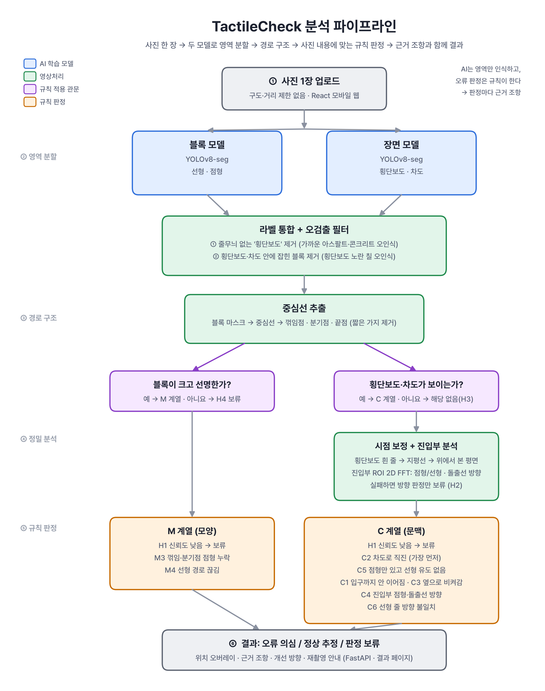

# TactileCheck BE

스마트폰 사진 **한 장**으로 횡단보도 주변 점자블록 설치 오류를 찾아
**설치 오류 의심 / 정상 추정 / 판정 보류**로 알려 주는 서비스의 백엔드와 판정 파이프라인.
시민이 사진을 올리면 판정 결과와 근거 조항·개선 방향을 바로 보여 주고,
신고는 사진·위치와 함께 저장되어 관리 기관이 확인·처리할 수 있다.

2026 AI 우왕톤 TEAM 47

| | 주소 |
| --- | --- |
| API (배포) | https://3-107-144-61.sslip.io (`/api/health`로 상태 확인) |
| 프론트 연동 가이드 | [docs/API.md](docs/API.md) |

## 동작 방식



1. **영역 분할** — YOLOv8-seg 모델 두 개를 함께 쓴다 ([pipeline/dual_segment.py](pipeline/dual_segment.py))
   - 블록 모델: 선형·점형 블록
   - 장면 모델: 횡단보도·차도 (5클래스 모델은 골목·보도·점자블록 영역도 검출)
   - 줄무늬 없는 가짜 횡단보도 제거 → 횡단보도·차도 안의 블록 오인식 제거 → 라벨 마스크 하나로 합침
   - 장면 모델에 점자블록(tactile) 클래스가 있으면 이중 검출: 서로 동의하지 않는 블록은 버리고,
     블록 모델이 놓친 블록 영역이 있으면 해당 판정을 보류로 돌린다
2. **경로 구조** — 마스크 중심선 → 끝점·꺾임점·분기점 그래프 ([pipeline/skeleton.py](pipeline/skeleton.py))
3. **시점 보정** — 횡단보도 줄무늬로 위에서 본 시점을 복원하고, 진입부를 잘라 돌출선 방향을 FFT로 분석
   ([pipeline/rectify.py](pipeline/rectify.py)). 실패하면 방향 판정만 보류(H2)
4. **규칙 판정** — 사진에 보이는 것으로 적용할 규칙을 정한다 ([pipeline/rules/judge.py](pipeline/rules/judge.py))
   - 횡단보도·차도가 보이면 C 계열, 블록이 크고 선명하면 M 계열 (둘 다 해당하면 둘 다)
   - 확신이 없으면 오류로 단정하지 않고 '판정 보류' + 재촬영 안내

### 판정 코드

| 코드 | 내용 | 근거 |
| --- | --- | --- |
| M3 | 꺾임·분기점에 점형 누락 | 별표 1 제16호 나목(1) |
| M4 | 선형 경로 끊김 | 나목(2) |
| C1 | 블록 경로가 횡단보도까지 이어지지 않음 | 나목(2) 관련 원칙 |
| C2 | 선형블록이 차도를 향함 (위험) | 나목(2) 관련 원칙 |
| C3 | 횡단보도 방향 꺾임 안내 누락 | 나목(1)·(2) |
| C4 | 진입부 점형 없음·돌출선 방향 오류 | 나목(1)·(2) |
| C5 | 진입부 점형까지 선형 유도 없음 | 나목(2) 관련 원칙 |
| C6 | 선형 방향이 횡단보도 건너는 방향과 다름 | 나목(2) 관련 원칙 |
| H1~H4 | 판정 보류 (인식 신뢰도 낮음, 시점 보정 실패, 횡단보도 일부만 보임, 블록이 작음) | – |

근거는 「장애인ㆍ노인ㆍ임산부 등의 편의증진 보장에 관한 법률 시행규칙」 [별표 1] 제16호 점자블록
(법제처 원문 대조, [pipeline/rules/clauses.py](pipeline/rules/clauses.py)).
횡단보도를 직접 다룬 조항이 없는 규칙은 '관련 원칙'으로 표시한다.

## 배포 구조

```
브라우저 (React FE)
   │ HTTPS
   ▼
AWS EC2 t3.small ── Caddy (HTTPS, Let's Encrypt) ── Docker: FastAPI + 두 모델 (CPU 추론)
                                                      │
                                                      ▼
                                   Supabase: inspections 테이블 + 비공개 사진 버킷
UptimeRobot ── 6시간마다 /api/health/deep (모델·DB 연결 확인)
```

- 사진은 긴 변 1600px로 줄여 **비공개** 버킷에 저장하고 API를 통해서만 내보낸다 (얼굴·차량 번호 보호)
- Supabase secret 키·관리자 토큰은 서버 `.env`에만 둔다
- 서버 업데이트: `cd ~/tactilecheck && git pull && bash scripts/server_update.sh`

## 폴더 구조

```
app/
  main.py            FastAPI: 점검 접수·조회·사진, 관리자 API, 상태 확인
  storage.py         Supabase 저장 (없으면 메모리)
pipeline/
  schema.py          판정 결과 형식 (SCHEMA_VERSION, FE와 공유)
  dual_segment.py    ① 두 모델 통합 분할
  crosswalk.py       줄무늬 없는 가짜 횡단보도 제거
  segment.py         단일 모델 분할, 신뢰도 요약
  mask_refine.py     마스크 후처리
  skeleton.py        ② 중심선 → 경로 그래프
  rectify.py         ③ 시점 보정, 진입부 돌출선 FFT
  shape_rules.py     M3 꺾임·분기점 분석
  rules/             ④ 규칙 판정
    judge.py         판정 순서와 종합 판정 (judge_photo)
    m_rules.py       M3·M4
    c_rules.py       C1~C6
    hold.py          H1~H4 보류
    clauses.py       근거 조항·개선 방향
  run.py             파이프라인 진입점 (run_photo)
  synth.py           합성 마스크·장면 생성기 (테스트용)
training/            데이터 변환 스크립트, Colab 학습 노트북
tests/               pytest
docs/                API 가이드, Supabase SQL, JSON 예시, 파이프라인 그림
scripts/             디버그 스크립트, 서버 업데이트 스크립트
weights/             모델 가중치 (*_best.pt)
Dockerfile
```

## 로컬 실행

```bash
python3 -m venv .venv && source .venv/bin/activate
pip install -r requirements-dev.txt      # 서버 + 테스트
pip install -r requirements-ml.txt       # 모델 추론까지 할 때
cp .env.example .env                     # Supabase를 비워 두면 메모리에 저장
pytest
uvicorn app.main:app --reload --port 8000
```

```bash
curl -F photo=@sample.jpg -F memo="학교 앞 횡단보도" http://localhost:8000/api/inspections
```

Docker로 실행 (배포와 같은 방식):

```bash
docker build -t tactilecheck .
docker run --rm -p 7860:7860 --env-file .env tactilecheck
```

모델 없이 라벨 마스크로 규칙만 확인하기:

```python
from pipeline.run import analyze_label
from pipeline.rules.judge import judge_photo
from pipeline.schema import PhotoKind
from pipeline.synth import short_of_crosswalk   # 또는 cv2.imread("mask.png", 0)

label, _ = short_of_crosswalk()                  # 횡단보도 앞에서 끊긴 경로
photo = analyze_label(label, PhotoKind.WIDE)
print(judge_photo(photo, label).model_dump_json(indent=2))   # C1 오류 의심
```

라벨 마스크는 1채널 uint8, 픽셀 값은 `pipeline/schema.py`의 `MaskClass`
(0 배경, 1 선형, 2 점형, 3 횡단보도, 4 차도).

## API 요약

| 메서드 | 경로 | 설명 |
| --- | --- | --- |
| POST | `/api/inspections` | multipart `photo` (+ `address`, `memo`, `lat`, `lng`) → 판정 결과 |
| GET | `/api/inspections/{id}` | 결과 다시 보기 |
| GET | `/api/inspections/{id}/photo` | 저장된 사진 |
| GET | `/api/admin/inspections` | (관리자) 신고 목록, `status`·`overall` 필터 |
| GET·PATCH | `/api/admin/inspections/{id}` | (관리자) 상세 조회, 처리 상태·메모 변경 |
| GET | `/api/health`, `/api/health/deep` | 상태 확인 |

관리자 API는 `X-Admin-Token` 헤더가 필요하다. 자세한 필드와 예제 코드는 [docs/API.md](docs/API.md).

## 데이터와 라이선스

- 학습 데이터: AI Hub 데이터와 직접 촬영 사진. **AI Hub 데이터와 촬영 원본(얼굴·번호판)은 저장소에 올리지 않는다** (`.gitignore`)
- 모델: [Ultralytics YOLOv8](https://github.com/ultralytics/ultralytics) (AGPL-3.0)
